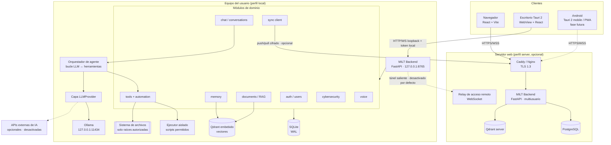
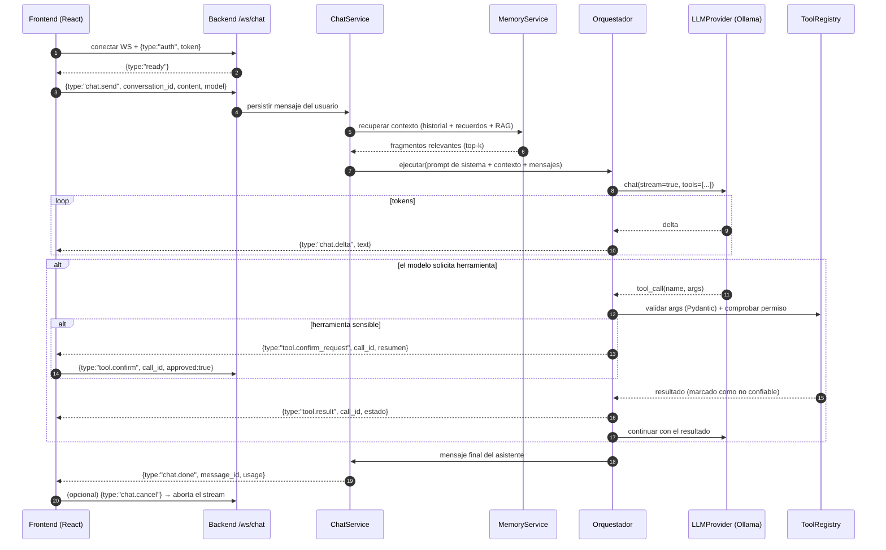
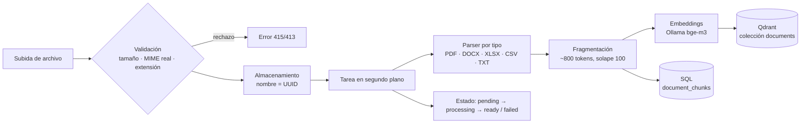

# 01 — Arquitectura técnica de MILT AI

## 1. Principios de arquitectura

1. **Local-first.** El núcleo (backend + Ollama + SQLite + almacén vectorial embebido) funciona sin Internet ni servidor web. La nube es un añadido, no una dependencia.
2. **Un solo backend, dos perfiles de despliegue.** El mismo código FastAPI se ejecuta como `MILT_PROFILE=local` (SQLite, Qdrant embebido, un solo usuario) o `MILT_PROFILE=server` (PostgreSQL, Qdrant en servidor, multiusuario). Las diferencias se resuelven con configuración e inyección de dependencias, no con forks del código.
3. **Monolito modular.** Un único proceso dividido en módulos por dominio con fronteras explícitas: cada módulo expone un servicio y no accede a las tablas de otro. Es más simple de operar que los microservicios y se puede dividir más adelante si hiciera falta.
4. **Proveedores de IA intercambiables.** Toda llamada a modelos pasa por la interfaz `LLMProvider`. Ollama es la implementación por defecto; las APIs externas son *plugins* opcionales y están desactivadas por defecto.
5. **Seguridad por defecto.** Herramientas con permisos explícitos, confirmación humana para acciones sensibles, acceso remoto desactivado y modelo tratado como **no confiable**.
6. **Contratos tipados de extremo a extremo.** Pydantic v2 genera OpenAPI y del OpenAPI se generan los tipos TypeScript del frontend. Así se evita la deriva entre los dos lados.

## 2. Diagrama de arquitectura general



**Decisión clave sobre el acceso remoto:** el equipo local **nunca abre puertos entrantes**. Si el usuario activa el acceso remoto, el backend local abre una conexión **saliente** WSS hacia el relay del servidor y las peticiones remotas se reenvían por ella, siempre autenticadas y autorizadas. Esto evita exponer el PC a Internet. Una alternativa documentada es Tailscale o WireGuard para quien prefiera una VPN.

## 3. Diagrama de comunicación frontend ↔ backend ↔ modelos

### 3.1 Chat con streaming y uso de herramientas



### 3.2 Por qué WebSocket para el chat (y REST para lo demás)

| Necesidad | Transporte |
|-----------|------------|
| Streaming de tokens, cancelación, confirmaciones de herramientas en mitad de una respuesta | **WebSocket**: bidireccional dentro del mismo turno |
| CRUD de conversaciones, memorias, documentos, ajustes | **REST**: cacheable, sencillo de probar y documentado con OpenAPI |
| Subida de archivos | REST `multipart/form-data` |
| Fallback si un proxy bloquea WS | `POST /chat/completions` con **SSE** (mismo contrato de eventos) |

### 3.3 Ingesta de documentos (RAG)



## 4. Descripción de los módulos

Cada módulo vive en `backend/app/modules/<nombre>/` con `router.py`, `service.py`, `repository.py`, `models.py` y `schemas.py`.

| # | Módulo | Responsabilidad | Componentes principales | Fase |
|---|--------|-----------------|--------------------------|------|
| 1 | **llm** (motor de IA) | Abstracción de proveedores, catálogo de modelos, parámetros, streaming, reintentos y detección de Ollama caído | `LLMProvider` (protocolo), `OllamaProvider`, `ProviderRegistry`, `ModelCatalog`, `GenerationParams` | 2 |
| — | **chat / conversations** | Conversaciones, mensajes, títulos automáticos, gestión de la ventana de contexto | `ChatService`, `ContextBuilder` (recorte por tokens), `/ws/chat` | 2 |
| — | **agents** | Bucle agente: LLM → herramienta → LLM, con un máximo de iteraciones y presupuesto de tiempo | `Orchestrator`, `AgentProfile` (general, código, seguridad) | 4–5 |
| 2 | **memory** | Memoria a corto plazo (historial), a largo plazo (hechos del usuario) y semántica (embeddings). Edición y borrado por el usuario | `MemoryService`, `MemoryExtractor` (propone recuerdos, el usuario aprueba), `EmbeddingService`, `VectorStore` (protocolo) | 4 |
| 3 | **coding** (asistente de programación) | Análisis de proyectos (árbol, lenguajes), lectura de archivos con límites, prompts especializados por lenguaje, explicación de errores | Herramientas `project.tree`, `file.read`, `code.search`; perfil de agente `coder` | 5 |
| 4 | **documents** | Ingesta, parsing, fragmentación, RAG con citas a la fuente, resúmenes | `IngestionPipeline`, parsers (`pypdf`, `python-docx`, `openpyxl`, `csv`), `Retriever` | 4 |
| 5 | **automation** | Ejecución de scripts de una lista blanca, flujos de trabajo (secuencias de herramientas), registro de operaciones | `ToolRegistry`, `PermissionPolicy`, `SandboxExecutor`, `WorkflowRunner` | 5 |
| 6 | **cybersecurity** | Análisis de logs (patrones e IoC), diagnóstico de la red **propia** (interfaces, puertos locales, DNS), auditoría de configuraciones y reportes | Herramientas `logs.analyze`, `net.diagnose`, `ioc.match`, `report.generate` | 5 |
| 7 | **voice** | STT local (faster-whisper), TTS local (Piper), *push-to-talk*, preparado para manos libres (VAD) | `SpeechToText`, `TextToSpeech` (protocolos), `/voice/*` | 5–6 |
| 8 | **auth / users / sessions** (acceso web) | Registro, login, Argon2id, JWT + refresh rotativo, roles, sesiones y dispositivos | `AuthService`, `TokenService`, `PasswordHasher`, `require_role()` | 2 / 7 |
| — | **sync** | Cliente de sincronización (local) y endpoints push/pull (servidor) | `SyncClient`, `SyncService`, `ChangeLog` | 7 |
| — | **audit** | Registro inmutable de acciones sensibles | `AuditService` | 2 |

### 4.1 Interfaz del proveedor de IA (contrato)

```python
class LLMProvider(Protocol):
    name: str
    async def list_models(self) -> list[ModelInfo]: ...
    async def health(self) -> ProviderHealth: ...
    def chat_stream(
        self, messages: list[ChatMessage], *, model: str,
        params: GenerationParams, tools: list[ToolSpec] | None = None,
    ) -> AsyncIterator[ChatChunk]: ...
    async def embed(self, texts: list[str], *, model: str) -> list[list[float]]: ...
```

`ChatChunk` es una unión discriminada: `TextDelta | ToolCallRequest | Done(usage)`. El orquestador solo conoce este contrato, nunca el formato de Ollama.

## 5. Tecnologías y versiones recomendadas

> Política: se fijan **rangos compatibles** aquí y las **versiones exactas** se congelan en Fase 2 con archivos de bloqueo (`uv.lock`, `pnpm-lock.yaml`, `Cargo.lock`). Antes de congelarlas se verifica que cada paquete tenga *wheels* para la versión de Python elegida.

### Backend

| Tecnología | Versión | Justificación |
|------------|---------|---------------|
| **Python** | **3.12.x** (3.13 aceptable) | Tu equipo tiene 3.15, pero varias dependencias con extensiones nativas (Qdrant/Chroma, faster-whisper/ctranslate2, argon2-cffi, pydantic-core) tardan en publicar *wheels* para versiones nuevas. 3.12 es la opción más segura para todo el ecosistema |
| **uv** | ≥ 0.5 | Gestiona la versión de Python **por proyecto** (sin tocar tu 3.15), un entorno virtual y un lockfile reproducible |
| FastAPI | ≥ 0.115, < 1.0 | API async, OpenAPI automático, WebSockets nativos |
| Uvicorn | ≥ 0.30 (`[standard]`) | Servidor ASGI |
| Pydantic / pydantic-settings | 2.x | Validación y configuración por entorno |
| SQLAlchemy | 2.0.x (async) | ORM tipado (`Mapped[]`) con soporte para SQLite y PostgreSQL |
| aiosqlite / asyncpg | estables actuales | Drivers async para SQLite y PostgreSQL |
| Alembic | 1.13+ | Migraciones con `render_as_batch=True` (necesario en SQLite) |
| httpx | 0.27+ | Cliente HTTP async para Ollama y la sincronización |
| ollama (cliente Python oficial) | 0.4+ | `AsyncClient` con streaming y herramientas. Se envuelve en `OllamaProvider` |
| qdrant-client | 1.10+ | **Mismo cliente** en modo embebido (`path=`) y modo servidor (`url=`) |
| argon2-cffi | 23+ | Argon2id |
| PyJWT | 2.8+ | JWT firmado (HS256 en local, EdDSA/RS256 en servidor) |
| structlog | 24+ | Logs estructurados en JSON |
| pypdf · python-docx · openpyxl | estables | Parsers puros de Python, sin dependencias de sistema |
| python-magic / `filetype` | estable | Detección de MIME real. `filetype` es puro Python, preferido en Windows |
| faster-whisper · piper-tts | estables | Voz local (Fase 5–6, dependencias opcionales `[voice]`) |
| pytest · pytest-asyncio · ruff · mypy | estables | Pruebas, lint y tipado estricto |

### IA local

| Componente | Recomendación inicial | Nota |
|------------|-----------------------|------|
| Ollama | Última estable | Instalación nativa en Windows (aprovecha la GPU). **Todavía no está instalado en tu equipo** |
| Modelo de chat general | Familia **Qwen 3** (p. ej. `qwen3:8b`) | Muy buen español y soporte de *tool calling* |
| Modelo alternativo | Familia **Llama 3.x** (p. ej. `llama3.1:8b`) | Compatibilidad amplia |
| Modelo de código | Familia **Qwen Coder** (`qwen2.5-coder:7b` o sucesor) | Perfil `coder` |
| Embeddings | `bge-m3` (multilingüe) · alternativa `nomic-embed-text` | La dimensión se guarda por colección. Cambiar de modelo obliga a reindexar |

Los nombres de modelo **no se escriben en el código**: se descubren con `GET /api/tags` de Ollama y los valores por defecto se configuran en `.env`.

> **Perfil del equipo de desarrollo (confirmado):** CPU sin GPU dedicada y ~10 GB de RAM. Por defecto se usa `qwen3:4b` para chat y `nomic-embed-text` para embeddings, con `num_ctx=4096`. Los modelos de 7–8 B quedan como opción manual. Ver [07 §4](07-plan-y-riesgos.md#4-decisiones-aprobadas-y-perfil-de-hardware).

### Frontend

| Tecnología | Versión | Justificación |
|------------|---------|---------------|
| Node.js | 22 LTS o 24 (tienes 24) | — |
| pnpm | 9+ | Rápido y estricto con dependencias fantasma |
| React | 19.x | — |
| TypeScript | 5.x (`strict`) | — |
| Vite | 6+ | — |
| Tailwind CSS | 4.x (`@tailwindcss/vite`) | Configuración CSS-first con *design tokens* como variables CSS |
| TanStack Query | 5.x | Caché del servidor y reintentos |
| Zustand | 5.x | Estado de UI (tema, panel abierto, conversación activa) |
| React Router | 7.x | Rutas |
| react-markdown + rehype-highlight / Shiki | estables | Render de Markdown y código |
| openapi-typescript | 7.x | Tipos generados desde el OpenAPI del backend |
| Vitest + Testing Library + Playwright | estables | Pruebas unitarias y E2E |

### Escritorio e infraestructura

| Tecnología | Versión | Nota |
|------------|---------|------|
| Tauri | **2.x** | Necesita **Rust (rustup, toolchain MSVC)** y WebView2. **Rust no está instalado** en tu equipo |
| Empaquetado del backend | PyInstaller (sidecar de Tauri) | El backend se distribuye como ejecutable sidecar que Tauri lanza y supervisa |
| Docker / Compose | Docker 29 (instalado) · Compose v2 | Perfil servidor y entorno de desarrollo de PostgreSQL y Qdrant |
| PostgreSQL | 16 o 17 | — |
| Qdrant server | 1.x (misma *major* que el cliente) | — |
| Caddy | 2.x | HTTPS automático (Let's Encrypt) |

### ¿Qdrant o ChromaDB?

Se elige **Qdrant**:
- `qdrant-client` funciona **embebido** (archivo local, sin servidor) y en **modo servidor** con la misma API. Encaja con los dos perfiles.
- Filtros de metadatos potentes (`user_id`, `conversation_id`, `source`), necesarios para el aislamiento multiusuario.
- ChromaDB arrastra más dependencias nativas y su API ha cambiado varias veces entre versiones.
- Queda detrás del protocolo `VectorStore`, así que se puede cambiar sin tocar los módulos.

## 6. Identidad visual

**Concepto:** "núcleo de luz". Una interfaz oscura y calmada donde la energía (azul, violeta, cian) aparece solo en los puntos de interacción: el foco del input, el streaming y el estado del modelo.

| Token | Oscuro | Claro | Uso |
|-------|--------|-------|-----|
| `--bg` | `#0A0D14` | `#F7F8FC` | Fondo base |
| `--surface` | `#11151F` | `#FFFFFF` | Sidebar y tarjetas |
| `--surface-2` | `#181D2A` | `#EEF1F8` | Burbujas y campos |
| `--border` | `#232A3B` | `#DCE1EC` | Separadores |
| `--text` | `#E6E9F2` | `#141824` | Texto principal |
| `--muted` | `#8A93A8` | `#5B6478` | Texto secundario |
| `--primary` | `#3B82F6` (azul eléctrico) | `#2563EB` | Acciones |
| `--accent` | `#8B5CF6` (violeta) | `#7C3AED` | IA y modelo activo |
| `--cyan` | `#22D3EE` | `#0891B2` | Modo local, streaming |
| `--danger` / `--warn` / `--ok` | `#F43F5E` / `#F59E0B` / `#10B981` | equivalentes AA | Estados |

- **Gradiente de marca:** `linear-gradient(135deg, #3B82F6, #8B5CF6 55%, #22D3EE)`, usado solo en el logotipo, el borde del input con foco y el indicador "pensando".
- **Tipografía:** *Inter* (interfaz) y *JetBrains Mono* (código y métricas), ambas autoalojadas para funcionar sin conexión.
- **Logotipo:** monograma "M" formado por tres trazos que convergen en un nodo central (local, web y memoria), con el gradiente de marca.
- **Movimiento:** transiciones de 150–200 ms, cursor de streaming que pulsa en cian y "respiración" suave del logotipo mientras el modelo genera. Se respeta `prefers-reduced-motion`.
- **Distribución:** sidebar colapsable (historial, nueva conversación, buscar), cabecera con **selector de modelo**, **insignia LOCAL (cian) / WEB (violeta)** y estado de Ollama. Paneles laterales deslizables para Memoria y Configuración. Input flotante con adjuntar, micrófono y enviar/detener.
- **Accesibilidad:** contraste WCAG AA, foco visible y navegación completa por teclado (`Ctrl+K` buscar, `Ctrl+Shift+O` nueva conversación).
