# 03 — Modelo de base de datos inicial

Un mismo esquema para **SQLite** (local) y **PostgreSQL** (servidor), gestionado con Alembic. Los tipos portables son: `GUID` (UUID nativo en PostgreSQL, `CHAR(36)` en SQLite) y `JSON` (`JSONB` en PostgreSQL, `TEXT` con JSON en SQLite).

## Columnas comunes (mixins)

| Mixin | Columnas | Uso |
|-------|----------|-----|
| `TimestampMixin` | `created_at`, `updated_at` | Todas las tablas |
| `SyncMixin` | `version INT`, `updated_hlc TEXT`, `deleted_at NULL`, `origin_device_id` | Entidades sincronizables (borrado lógico = *tombstone*) |

## Diagrama entidad-relación

```mermaid
erDiagram
    users ||--o{ refresh_tokens : tiene
    users ||--o{ devices : registra
    users ||--o{ conversations : posee
    users ||--o{ memories : posee
    users ||--o{ documents : posee
    users ||--|| user_settings : configura
    users ||--o{ audit_log : genera
    conversations ||--o{ messages : contiene
    messages ||--o{ tool_executions : dispara
    messages ||--o{ message_attachments : adjunta
    documents ||--o{ document_chunks : divide
    documents ||--o{ message_attachments : referenciado
    devices ||--o{ refresh_tokens : vincula
    users ||--o{ sync_cursors : sincroniza

    users {
        uuid id PK
        string email UK "normalizado a minúsculas"
        string display_name
        string password_hash "Argon2id"
        string role "admin | user"
        bool is_active
        int failed_logins
        datetime locked_until
        datetime last_login_at
    }
    refresh_tokens {
        uuid id PK
        uuid user_id FK
        uuid device_id FK
        string token_hash UK "SHA-256, nunca el token"
        uuid family_id "detección de reutilización"
        datetime expires_at
        datetime revoked_at
        string ip
        string user_agent
    }
    devices {
        uuid id PK
        uuid user_id FK
        string name
        string platform "windows | web | android"
        bool remote_access_enabled "false por defecto"
        string public_key "para cifrado de sincronización"
        datetime last_seen_at
    }
    conversations {
        uuid id PK
        uuid user_id FK
        string title
        string model "último modelo usado"
        string agent_profile "general | coder | security | documents"
        json params "temperatura, top_p, num_ctx"
        bool pinned
        bool archived
        bool sync_enabled "true por defecto en web, configurable"
    }
    messages {
        uuid id PK
        uuid conversation_id FK
        string role "system | user | assistant | tool"
        text content
        string model
        json tool_calls
        int prompt_tokens
        int completion_tokens
        int latency_ms
        string status "complete | cancelled | error"
    }
    tool_executions {
        uuid id PK
        uuid message_id FK
        uuid user_id FK
        string tool_name
        json arguments
        string risk_level "read | write | execute | network"
        string decision "auto | approved | denied | timeout"
        string status "ok | error"
        text result_summary
        int duration_ms
    }
    memories {
        uuid id PK
        uuid user_id FK
        text content
        string kind "fact | preference | project | instruction"
        string source "user | extracted | imported"
        uuid source_message_id
        float importance
        bool is_sensitive "excluido de la sincronización por defecto"
        string vector_id "id del punto en Qdrant"
        datetime last_used_at
    }
    documents {
        uuid id PK
        uuid user_id FK
        string filename "original, solo para mostrar"
        string storage_key "UUID en disco"
        string mime_type "detectado, no declarado"
        int size_bytes
        string sha256
        string status "pending | processing | ready | failed"
        text error
        string embedding_model
        int chunk_count
    }
    document_chunks {
        uuid id PK
        uuid document_id FK
        int ordinal
        text content
        json locator "página, hoja, fila"
        int token_count
        string vector_id
    }
    message_attachments {
        uuid message_id FK
        uuid document_id FK
    }
    user_settings {
        uuid user_id PK
        string theme "dark | light | system"
        string default_model
        string embedding_model
        json generation_defaults
        json allowed_roots "carpetas accesibles por herramientas"
        json tool_policies "sobrescrituras por herramienta"
        bool memory_auto_extract
        string language
    }
    audit_log {
        bigint id PK
        uuid user_id FK
        string action "auth.login, tool.execute, memory.delete…"
        string target_type
        string target_id
        string outcome "success | failure | denied"
        string ip
        json details "sin secretos ni contenido sensible"
        string prev_hash "encadenamiento para detectar manipulación"
        datetime created_at
    }
    sync_cursors {
        uuid user_id FK
        uuid device_id FK
        bigint server_seq "último cambio recibido"
        datetime last_sync_at
    }
```

## Tabla adicional en el servidor: `change_log`

Solo existe en el perfil `server` y es la base del *pull* incremental:

| Columna | Tipo | Descripción |
|---------|------|-------------|
| `seq` | BIGSERIAL PK | Secuencia monotónica global |
| `user_id` | UUID | Propietario (todas las consultas filtran por él) |
| `entity` | TEXT | `conversation`, `message` o `memory` |
| `entity_id` | UUID | — |
| `op` | TEXT | `upsert` o `delete` |
| `payload` | JSONB / BYTEA | Entidad serializada (cifrada si E2E está activo) |
| `device_id` | UUID | Dispositivo de origen (para no devolverle su propio cambio) |

## Índices principales

- `conversations (user_id, updated_at DESC) WHERE deleted_at IS NULL`: listado de la sidebar.
- `messages (conversation_id, created_at)`: carga del historial.
- `memories (user_id, kind)` y `documents (user_id, status)`.
- `refresh_tokens (token_hash)` único y `(family_id)`.
- `audit_log (user_id, created_at)` y `(action, created_at)`.
- Búsqueda textual del historial: **FTS5** en SQLite y `tsvector` + GIN en PostgreSQL, detrás del repositorio `MessageSearch`.

## Almacén vectorial (Qdrant)

| Colección | Payload (filtrable) | Origen |
|-----------|---------------------|--------|
| `memories__{modelo}` | `user_id`, `memory_id`, `kind` | Tabla `memories` |
| `documents__{modelo}` | `user_id`, `document_id`, `chunk_id`, `locator` | Tabla `document_chunks` |
| `messages__{modelo}` | `user_id`, `conversation_id`, `message_id` | Historial semántico (opcional) |

- El sufijo `{modelo}` (p. ej. `bge-m3`) evita mezclar vectores de distinta dimensión. Cambiar de modelo de embeddings crea una colección nueva y lanza una reindexación.
- **SQL es la fuente de verdad.** Qdrant es un índice derivado que siempre se puede reconstruir. **Los vectores no se sincronizan**: cada nodo los regenera a partir del texto.
- Toda búsqueda incluye un filtro obligatorio `user_id`, aplicado por el `VectorStore` y no por quien lo llama.
