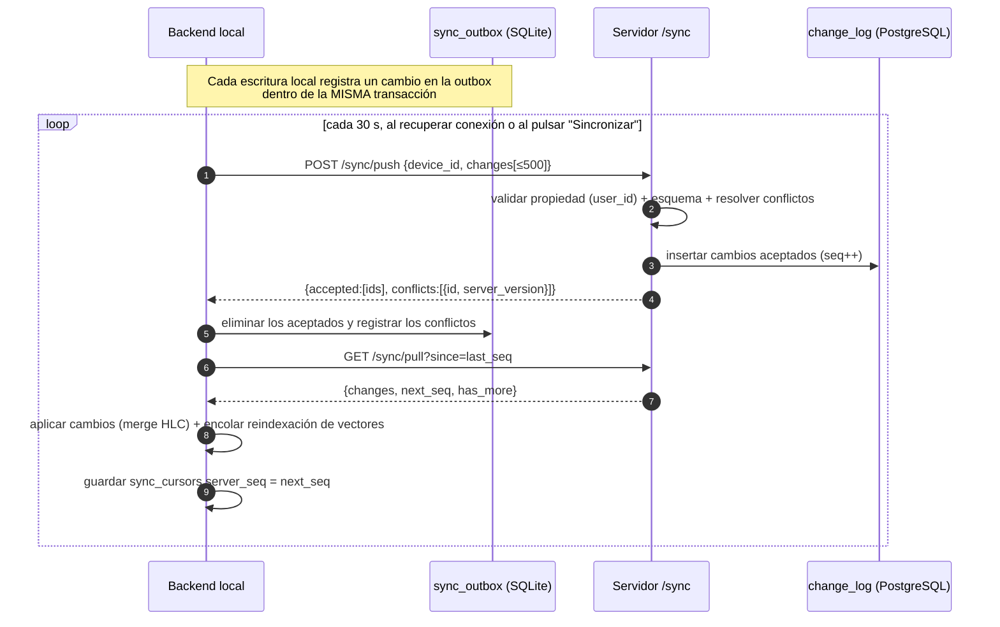

# 05 — Funcionamiento offline y sincronización

## 1. Funcionamiento offline

El nodo local es **autónomo**. Toda la funcionalidad básica depende solo de recursos del propio equipo:

| Función | Recurso local | ¿Necesita Internet? |
|---------|---------------|---------------------|
| Chat y streaming | Ollama (`127.0.0.1:11434`) | No |
| Historial, conversaciones, ajustes | SQLite (`%APPDATA%\MILT\milt.db`) | No |
| Memoria semántica y RAG | Qdrant embebido + embeddings en Ollama | No |
| Documentos | Parsers en Python + disco local | No |
| Herramientas y automatización | Ejecutor local | No |
| Voz | faster-whisper + Piper (modelos descargados una vez) | No (solo la primera descarga) |
| Interfaz | Recursos empaquetados en Tauri, fuentes autoalojadas, sin CDN | No |
| Descargar modelos nuevos | `ollama pull` | Sí (puntual) |
| Sincronización y acceso remoto | Servidor | Sí (opcional) |

**Degradación controlada:**
- Si **Ollama no responde**, el backend sigue sirviendo historial, memoria y documentos. El chat devuelve `chat.error {code:"provider_unavailable"}` y la interfaz muestra "Motor local detenido" con un botón de reintento. Un *health check* cada 10 s lo detecta.
- Si **el servidor no está disponible**, los cambios se acumulan en una cola (`sync_outbox`) y el indicador pasa a "Sin sincronizar (n)". Nunca bloquea al usuario.
- **Arranque:** el backend local no intenta contactar con ningún servicio externo salvo que la sincronización esté activada.

## 2. Modelo de sincronización

**Opcional, desactivada por defecto, por usuario y con exclusiones por entidad.**

### 2.1 Qué se sincroniza

| Entidad | ¿Se sincroniza? | Estrategia de conflicto |
|---------|-----------------|-------------------------|
| `messages` | Sí | **Solo se añaden** (*append-only*). El ID UUIDv7 es único globalmente, así que no hay conflicto. Editar o borrar crea una nueva versión o una *tombstone* |
| `conversations` (metadatos) | Sí (salvo `sync_enabled=false`) | **LWW por campo** con reloj HLC. Ejemplo: el título se cambia en A y "fijada" en B, y se conservan los dos cambios |
| `memories` | Sí, **excepto** `is_sensitive=true` | LWW. Si los dos lados editaron el contenido desde la última versión común, se guardan ambos y se marca un conflicto para que el usuario elija |
| `user_settings` | Parcial (tema, modelo por defecto) | LWW |
| `documents` | Solo metadatos (opcional). **Los archivos no** salvo opción explícita | — |
| Vectores (Qdrant) | **Nunca** | Se regeneran en cada nodo |
| `allowed_roots`, políticas de herramientas, scripts | **Nunca** | Son específicos del equipo y sensibles para la seguridad |
| `audit_log` | Nunca (cada nodo mantiene el suyo) | — |

### 2.2 Relojes y versiones

- **HLC** (*Hybrid Logical Clock*: `tiempo_físico_ms:contador:device_id`) en `updated_hlc`. Ordena eventos entre dispositivos aunque los relojes no estén bien sincronizados.
- `version` se incrementa en cada cambio local y sirve para la detección optimista de conflictos.
- Borrados como *tombstones* (`deleted_at`), purgados a los 90 días tras confirmar que todos los dispositivos ya los recibieron.

### 2.3 Protocolo

- **Idempotencia:** reenviar el mismo cambio (mismo `id` + `version`) no tiene efecto. Si se corta la red a mitad, se reintenta sin duplicar.
- **Reintentos:** *backoff* exponencial con *jitter* (de 1 s hasta 5 min).
- **Lotes:** como máximo 500 cambios o 2 MB por petición.

### 2.4 Seguridad de la sincronización

- Solo por **HTTPS/TLS 1.3** contra el dominio configurado. *Certificate pinning* opcional en el escritorio.
- Cada dispositivo se registra y obtiene un **refresh token propio**, revocable desde `/sessions`.
- **Cifrado de extremo a extremo (opcional, recomendado):** la carga (`payload`) se cifra en el cliente con una clave derivada de una frase de paso del usuario (Argon2id → clave de 256 bits, cifrado XChaCha20-Poly1305 o AES-256-GCM). El servidor solo guarda texto cifrado y metadatos mínimos (`entity`, `id`, `hlc`).
  - Contrapartida: con E2E activo, **la versión web no puede buscar ni hacer RAG en el servidor** sobre ese contenido, y perder la frase de paso supone perder los datos sincronizados. Se ofrece como opción explícita.

## 3. Acceso remoto al equipo local

Desactivado por defecto. Al activarlo:

1. El usuario lo habilita **desde el propio equipo** (nunca desde remoto) y se registra en auditoría.
2. El backend local abre un **WSS saliente** a `/relay/connect`, autenticado con la credencial del dispositivo.
3. Las peticiones remotas del mismo usuario (login, y opcionalmente 2FA en Fase 7) se reenvían por el túnel.
4. Las herramientas con riesgo `execute` o `write` **quedan denegadas por defecto en sesiones remotas**, aunque localmente estén permitidas con confirmación.
5. Indicador visible en la interfaz local ("Acceso remoto ACTIVO") y botón para cortar al instante.
